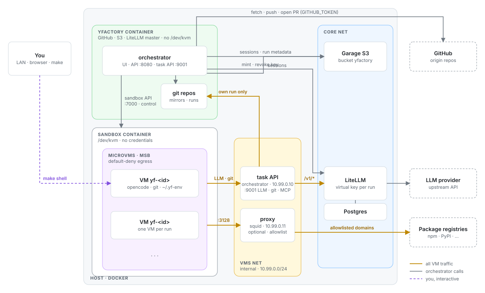
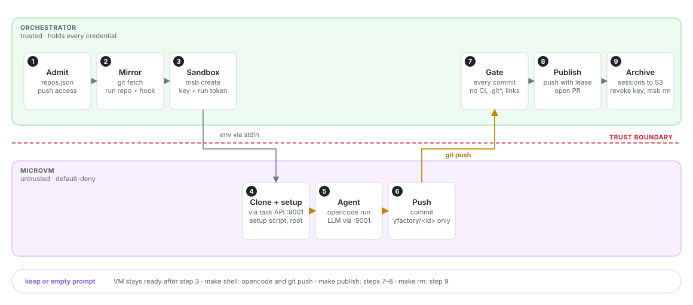
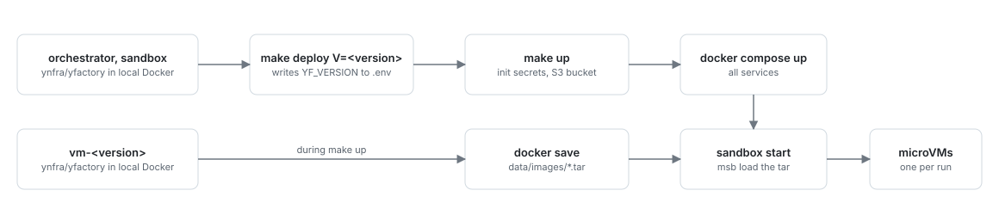

# Architecture

Operations: [README.md](../README.md), services: [SERVICES.md](SERVICES.md). The diagrams are generated from the yfactory source and follow the light or dark theme of the viewer.

## Components and trust

The orchestrator holds the provider token, the LiteLLM master key and the S3 keys. VMs (microVMs) run in a separate `sandbox` container that has `/dev/kvm` but no credentials and is not on the core network; the orchestrator drives it through an internal API. A microVM reaches only the task API of the orchestrator on `10.99.0.10:9001` (LLM routes and the git repository of its own run, with the run token) and the package proxy with its domain allowlist. Everything else, including LiteLLM directly, Garage, the orchestrator UI, the host and the LAN, is blocked by msb default-deny egress. The one way in is code-server: `sandbox` forwards a port of `127.0.0.1` inside its own container to the VM, and `yfactory` proxies it on `:8081` (host `:8092`), a separate origin from the UI, because code-server serves pages that the VM controls. The `sandbox` container also has an `egress` network, because msb networking needs a default route.

## Run lifecycle

The VM receives only a run token (the virtual LiteLLM key stays in the orchestrator, which swaps it in) through stdin into `~/.yf-env`, never through argv. It may push only `yfactory/<id>` into the run repository; a pre-receive hook rejects anything else. Nothing reaches the provider until the orchestrator has checked every commit: `.git`, `.github`, `.gitea`, `.forgejo`, `.gitlab-ci.yml`, `.gitmodules` and `.gitattributes` are rejected, as are symlinks, submodules and merge commits, and more than 200 commits. `.gitignore` is allowed. Sessions and run metadata go to S3 even when a run fails.

## Deploy

The sandbox service has no Docker access, so the VM image reaches msb as a `docker save` tar in `data/images/`; it has its own version and changes rarely, so most deploys reuse the tar. Restarting `yfactory` keeps ready VMs, their run tokens and LiteLLM key aliases are stored in `runs.json`; a run in progress becomes `failed`. Restarting `sandbox` stops every VM.
